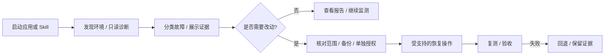
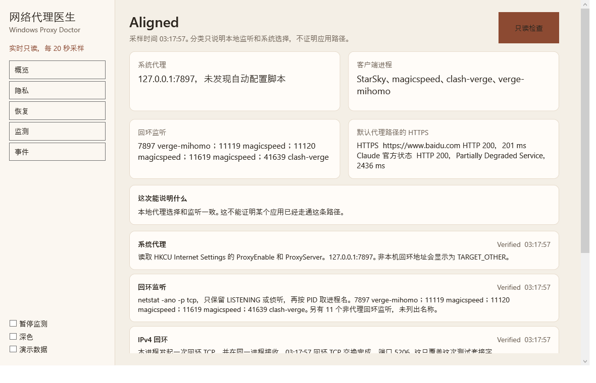
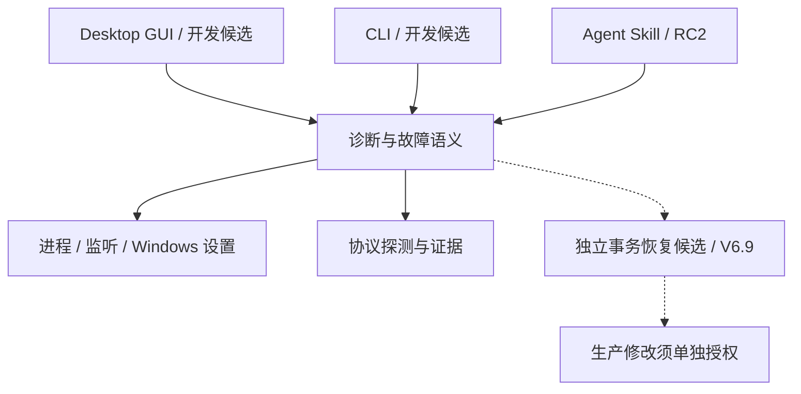
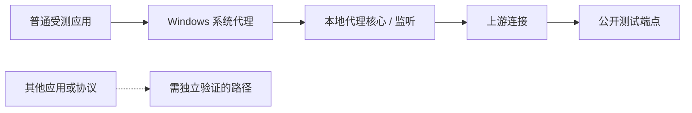

<div align="center">

# Windows Proxy Doctor · 网络代理医生

**Windows Static Proxy Lab**

面向 Windows 的网络健康诊断、隐私检查与故障恢复工程

[快速开始](#快速开始) · [桌面应用](#桌面应用) · [agent-skill](#agent-skill) · [底层工程](#底层工程) · [故障手册](#故障处理) · [开发与验收](#开发与验收)

`Windows 10/11` · `.NET 8 / WPF` · `PowerShell 5.1+` · `Python` · `Source Preview / RC`

</div>

> [!IMPORTANT]
> 本项目源于 Claude 等 AI 服务的连接故障、网络路径异常与账户安全顾虑，目标是提供可审计的 Windows 网络可靠性和个人隐私工具。它不是 Claude 官方产品，不承诺防止封禁，不替代服务资格或官方申诉，也不实现账号处置、地域资格或身份验证规避。**源代码合并 ≠ 稳定版发布 ≠ 本机生产部署。**

## 项目概览

Windows Proxy Doctor 将历轮网络实验、事务恢复脚本、Agent Skill 与桌面诊断应用组织为同一产品体系。用户可以按需要选择可视化应用、自然语言助手或命令行，而不必手动阅读全部历史测试日志。每项能力分别记录测试方法、实际观测和覆盖范围。

| 入口 | 面向用户 | 当前版本及获取方式 |
| --- | --- | --- |
| 桌面应用 | 希望通过 GUI 查看网络状态、监测与故障建议的 Windows 用户 | [Desktop 1.0 开发候选 / PR #5](https://github.com/LYL-Z/windows-static-proxy-lab/pull/5) |
| Agent Skill | 使用 Codex 或兼容 Agent Skills 的用户 | [2.0.0 RC2 · 主支源码](skills/windows-proxy-doctor/) |
| CLI | 开发者、脚本调用者、诊断自动化 | [桌面候选 CLI](https://github.com/LYL-Z/windows-static-proxy-lab/tree/93024cb9d4f3ff195b3b82d714cd503beaa3632a/desktop/src/ProxyDoctor.Cli) · [Skill 脚本](skills/windows-proxy-doctor/scripts/) |
| 底层事务工程 | 需要审查配置应用、恢复与隔离实验的开发者 | [V6.9 候选 / PR #4](https://github.com/LYL-Z/windows-static-proxy-lab/pull/4) |

## 快速开始

### 选择适合自己的入口

1. **普通 Windows 用户：** 优先使用桌面候选进行只读检查；没有发布包时，从指定源码提交构建。不要将其他来源的未知 EXE 当作官方发行文件。
2. **Agent 用户：** 安装本仓库的 Skill，重新加载 Agent，然后用自然语言说明问题。
3. **开发者：** 使用 CLI 或测试脚本查看结构化证据。事务脚本涉及系统状态变化时，先审查发布门槛与回滚流程。
4. **所有用户：** 保留现有正常网络，不需要为诊断功能购买指定代理服务。涉及安装、付款、凭据输入和生产修改时应分别核实、授权。

### 从一句自然语言开始

> 用 Windows Proxy Doctor 检查我的网络，先只读检查，告诉我故障在哪里和下一步该怎么做。



## 桌面应用

**Windows Proxy Doctor Desktop 1.0 — 开发候选。** 基于 C#、.NET 8、WPF 与 CommunityToolkit.Mvvm。默认以普通用户身份运行。

[](https://github.com/LYL-Z/windows-static-proxy-lab/blob/93024cb9d4f3ff195b3b82d714cd503beaa3632a/desktop/overview.png)

截图来自该候选的实机运行记录，不能代表当前访问者的网络状态。

| 功能 | 当前候选状态 |
| --- | --- |
| 网络概览、客户端进程与监听 | 实时读取 |
| 故障分类与建议 | 已有只读实现 |
| HTTPS 状态码与耗时 | 已有实际探测；仅覆盖受测路径 |
| 20 秒本地状态监测、暂停及托盘 | `93024cb` 已实现；不等同长期或瞬时全覆盖 |
| IPv4/IPv6 回环检查 | 已有现场检查入口；回环不代表公网数据面 |
| Claude 官方服务状态 | 候选已有状态接口检查；并非完整账户健康或资格判断 |
| 隐私协议检查 | 部分历史/实时结果；未测路径保持未验证 |
| 恢复演练 | 内存演练，不写系统代理 |
| 生产自动修复、全局网络阻断 | 尚未部署或完成验收 |
| 安装包与代码签名 | 本地 win-x64 便携构建；未签名，无正式 MSI 发布 |

### 从候选源码构建

在 Windows 上准备 Git 与 [.NET 8 SDK](https://dotnet.microsoft.com/download/dotnet/8.0)。以下为可重复的候选源码构建流程，不替换生产网络配置。

```powershell
git clone https://github.com/LYL-Z/windows-static-proxy-lab.git
cd windows-static-proxy-lab
git switch --detach 93024cb9d4f3ff195b3b82d714cd503beaa3632a
cd desktop
dotnet test .\ProxyDoctor.sln -c Release
dotnet publish .\src\ProxyDoctor.Desktop\ProxyDoctor.Desktop.csproj -c Release -r win-x64 --self-contained true -o .\publish\win-x64
.\publish\win-x64\ProxyDoctor.exe
```

### 使用、更新与卸载

- 启动后选择只读检查，展开实际结果，区分演示数据、历史证据和本机实时数据。
- 使用托盘与本地监测查看状态变化；暂停和退出时应停止相应监测。
- `Aligned` 只表示观察到的代理选择和监听一致，并不证明任意应用或协议已经经过预期路径。
- 便携版退出后删除其发布目录即可移除程序文件；本地意图和事件记录可能保留在 `%LOCALAPPDATA%\ProxyDoctor`，如不再需要，可先备份再由用户自行清理。
- 更新时保留上一版本发布目录。自行构建的二进制 SHA-256 可能因构建环境不同而变化；候选原始发布哈希见 [SHA256SUMS.txt](https://github.com/LYL-Z/windows-static-proxy-lab/blob/93024cb9d4f3ff195b3b82d714cd503beaa3632a/desktop/SHA256SUMS.txt)。SHA-256 不是 Authenticode 代码签名。

[桌面源码](https://github.com/LYL-Z/windows-static-proxy-lab/tree/93024cb9d4f3ff195b3b82d714cd503beaa3632a/desktop) · [架构](https://github.com/LYL-Z/windows-static-proxy-lab/blob/93024cb9d4f3ff195b3b82d714cd503beaa3632a/desktop/ARCHITECTURE.md) · [安全说明](https://github.com/LYL-Z/windows-static-proxy-lab/blob/93024cb9d4f3ff195b3b82d714cd503beaa3632a/desktop/SECURITY.md)

## Agent Skill

**Windows Proxy Doctor 2.0.0 RC2** 已合入主支作为候选源码。支持 Windows 10/11、Windows PowerShell 5.1 与兼容的后续 PowerShell 主机。实际执行能力取决于 Agent 是否拥有本地 Windows shell 与对应权限。

### 安装

1. 下载或克隆本仓库 `main`，保留完整的 `skills/windows-proxy-doctor` 文件夹。
2. 将内层 `windows-proxy-doctor` 复制到 Codex 项目的 `.agents/skills/` 或其他兼容 Agent 文档所指定的 Skill 目录。
3. 确认安装目录直接包含 `SKILL.md` 和 `scripts/`，然后重新加载 Agent 会话。
4. 输入下面任一自然语言指令，先进行只读诊断。

| 使用场景 | 示例指令 |
| --- | --- |
| 首次使用 | 用 Windows Proxy Doctor 检查我的网络 |
| 新手准备 | 帮我准备代理设置，我还没有相关软件 |
| 无网络流量 | 检查我的代理为什么没有正常工作 |
| 客户端重连 | StarSky 已经重新开启，但 Clash 没有流量 |
| 配置审核 | 检查我的电脑网络配置是否正常 |
| 恢复辅助 | 检查网络故障并提供恢复方案 |

Skill 会发现本机环境、识别故障、提供操作建议，并在用户拒绝某项修改后继续安全范围内的诊断。不会默认提权、自动注册付款或要求用户在对话中提交密码。

### PowerShell 只读入口

在 `skills/windows-proxy-doctor` 目录运行：

```powershell
powershell.exe -NoProfile -File .\scripts\Start-ProxyDoctor.ps1 -Goal Auto -Json
powershell.exe -NoProfile -File .\scripts\Get-ProxyDoctorEnvironment.ps1 -Json
```

前台观察、显式 HTTPS 探测、检查点以及软件完整性验证的参数参见下列文档。升级前退出正在使用的观察脚本，备份原 Skill，再替换完整文件夹；卸载或回退不应修改 Windows 网络设置。

[Skill 使用说明](skills/windows-proxy-doctor/README.md) · [新手指南](skills/windows-proxy-doctor/references/getting-started.md) · [环境发现](skills/windows-proxy-doctor/references/environment-discovery.md) · [权限与人工操作](skills/windows-proxy-doctor/references/user-interaction.md) · [发布门槛](skills/windows-proxy-doctor/RELEASE-GATE.md)

## 底层工程

历史工程从分层协议实验演进至配置事务与恢复机制。V6.9 候选继承并修复了快照回滚、用户主动关闭代理后的意图保留、日志异常、并发及异常退出等问题。



该图表达产品架构方向。不同入口的实现并非全部已共享同一个运行时；目前主要统一的是故障分类与证据语义。

| 工程路径 | 作用 |
| --- | --- |
| [`proxy_diag/`](proxy_diag/) | 历史分阶段协议探测与诊断 |
| [`proxy_v2/`](proxy_v2/) | 历史事务配置、回退和基准实验 |
| [`proxy_v3/`](proxy_v3/) | 状态机、故障注入和网络协议观察 |
| [`proxy_v4/`](proxy_v4/) | 主支历史事务引擎；最新候选仍在 PR #4 |
| [V6.9 测试与验收](https://github.com/LYL-Z/windows-static-proxy-lab/blob/a6e65c31bb0bef8b42ba3832fb24fe30cb28cc4e/docs/V69-ACCEPTANCE.md) | 当前候选验收矩阵 |
| [V6.9 部署及回滚](https://github.com/LYL-Z/windows-static-proxy-lab/blob/a6e65c31bb0bef8b42ba3832fb24fe30cb28cc4e/docs/V69-DEPLOY.md) | 尚未部署的候选及生产授权边界 |

### 典型环境的观测示意



示意图不是网络配置教程。系统代理状态、客户端 UI、监听归属与实际应用数据面需要分别验证。

## 故障处理

| 观察到的现象 | 推荐第一步 |
| --- | --- |
| StarSky 自行停止 | 记录发生时间和客户端状态，通过只读诊断核对监听及普通应用访问；原因尚未确定 |
| 上游恢复后 Clash 仍无流量 | 区分核心监听、系统代理与应用实际请求，按故障手册确认最小恢复操作 |
| 系统代理被关闭 | 区分观察到关闭与已知的用户主动选择，不擅自开启 |
| 两款客户端状态不一致 | 检查实际监听及代理所有权；不把界面开关当作数据面证据 |
| DNS、IPv6、WebRTC 结果不一致 | 查看对应协议的独立测量与测试范围；不把超时或空结果当作明确阻断 |
| Claude 等服务不可访问 | 先检查普通连接和官方服务状态；涉及账号或资格时走官方支持渠道 |

实际修复需要核对影响和权限。候选自动恢复尚未生产验收，桌面恢复演练不修改系统。

[完整故障手册](skills/windows-proxy-doctor/references/troubleshooting.md) · [生命周期现场记录](skills/windows-proxy-doctor/references/lifecycle-observations.md) · [已知可靠性缺口](skills/windows-proxy-doctor/references/reliability-gaps.md) · [Claude 官方服务状态](https://status.claude.com/) · [Anthropic 官方支持](https://support.claude.com/)

## 八项需求与证据边界

原始八项要求已作为历史需求保存在 [需求原文与工程验收矩阵](docs/V6.9-EIGHT-REQUIREMENTS.md)。以下只概括可验证的通用工程能力，不把历史愿望等同于已实现功能。

| 工程能力 | 最新已记录的边界 |
| --- | --- |
| 网络失败关闭 | 隔离进程守卫仅覆盖其启动的作业；整机网络阻断未验收 |
| 浏览数据隐私 | 合成站点数据清理已有实验；不自动清理真实资料、不重置身份 |
| DNS / DoH | 隔离实验有证据；实际系统解析器和浏览器路径仍待测 |
| IPv6 | 回环拒绝/超时按不同状态记录；不代表公网路径已保护 |
| WebRTC / UDP | 临时浏览器或受控端点证据；真实应用和通话待验证 |
| 综合协议状态 | 按协议独立展示，不合成虚假的“全绿”安全等级 |
| 应用网络健康 | 普通 HTTPS 和官方状态可测，第三方账户资格不可由出口地址证明 |
| 客户端恢复 | 事务候选与隔离测试已有进展；生产无人值守恢复未部署 |

## 现场记录

下图为历史客户端界面，已按 Skill 发布资料处理遮盖。不是当前网络状态。

| StarSky | Clash Verge |
| --- | --- |
|  |  |

历史第三方检测截图仅用于解释不同协议的观测差异：[路径观察](docs/media/historical-path-observation.png) · [网络摘要](docs/media/historical-network-summary.png)。评分不代表平台账号风险，也不是项目验收指标。

## 开发与验收

截至 2026-11-25 的源代码和已报告测试记录：

| 工作线 | 证据对应版本 | 已记录的测试 | 发布状态 |
| --- | --- | --- | --- |
| Skill | `2e2b6c3` | 21 项故障分类；此前 `eb1d521` 另有 14 组诊断、24 组向导测试 | 主支 RC2 源码；新设备验收未完成 |
| V6.9 | `171d060`（说明提交 `a6e65c3`） | 114/114 隔离回归、0 跳过、退出码 0 | Draft；未部署 |
| Desktop | `93024cb` | 12/12 单元测试、构建与实机界面记录 | Draft；未签名开发候选 |

上述为各工作线已有测试记录，**不是合并后主支的统一 CI 结果**。本次主支文档整合没有重新执行 Windows 测试。完整发布前应对冻结候选进行回归、独立审查、隐私扫描和真实设备验收。

| PR | 内容及关系 |
| --- | --- |
| [#1](https://github.com/LYL-Z/windows-static-proxy-lab/pull/1) | V6 底层工程；发布安全事项未全部关闭 |
| [#2](https://github.com/LYL-Z/windows-static-proxy-lab/pull/2) | Skill RC2，已合入 main |
| [#3](https://github.com/LYL-Z/windows-static-proxy-lab/pull/3) | 历史需求与边界，已合入 main |
| [#4](https://github.com/LYL-Z/windows-static-proxy-lab/pull/4) | V6.9，基于 #1 |
| [#5](https://github.com/LYL-Z/windows-static-proxy-lab/pull/5) | 桌面端，基于 #4 |

## 路线图

- **Desktop：** 完善交互式逐项检测、可取消的持续监测、事件持久化、无障碍、故障恢复体验、正式安装包与签名。
- **Skill：** 统一故障语义，继续真实 Agent 与新设备端到端验收。
- **Engine：** 关闭历史安全问题，验证事务恢复、回滚与生产授权流程。
- **Release：** 在冻结源码、统一回归、安全审查和真实设备验收完成后发布稳定版；现阶段不宣称已经完成所有需求。

## 安全、许可证与贡献

默认最小权限。不要上传代理凭据、浏览器会话、私密快照、完整网络地址或带个人信息的日志。历史底层备份可能含敏感配置，必须在本地妥善保管。不要关闭安全防护来换取测试通过。

- [仓库安全说明](SECURITY-NOTES.md)
- [Skill 安全说明](skills/windows-proxy-doctor/SECURITY.md) 与 [MIT 许可证](skills/windows-proxy-doctor/LICENSE)
- [V6.9 发布门槛](https://github.com/LYL-Z/windows-static-proxy-lab/blob/a6e65c31bb0bef8b42ba3832fb24fe30cb28cc4e/proxy_v6/RELEASE-GATE-V6.md)
- [桌面第三方声明](https://github.com/LYL-Z/windows-static-proxy-lab/blob/93024cb9d4f3ff195b3b82d714cd503beaa3632a/desktop/THIRD-PARTY-NOTICES.md)

Skill 的 MIT 许可适用于其自身文件；其他组件按各自声明及依赖许可处理，不据此推定整个仓库采用同一许可证。供应商入口、费用和推荐奖励按 [披露文件](skills/windows-proxy-doctor/references/providers.md) 核实。

提交 Issue 时请包含 Windows 版本、客户端版本、故障发生时间、复现步骤、脱敏诊断和预期结果。贡献请基于独立分支，提供对应测试，不将本机配置或秘密写入版本库。

---

<div align="center">Windows Proxy Doctor · Evidence before claims · 安全、可验证、可恢复</div>
