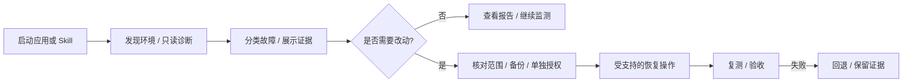
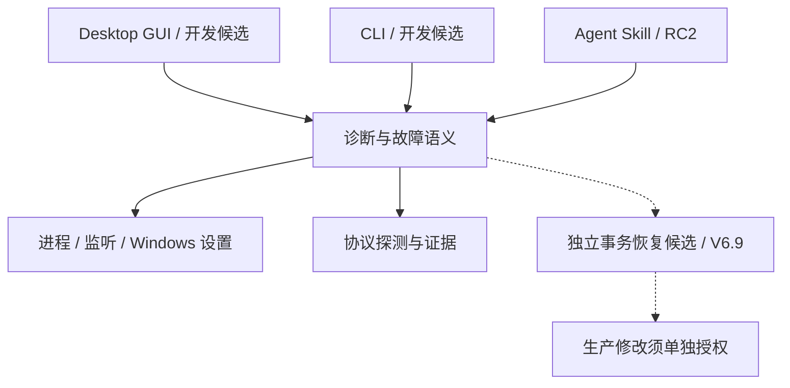
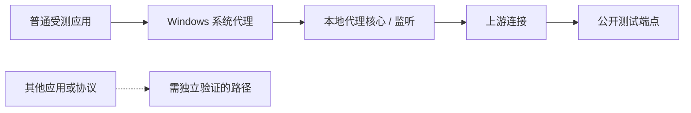
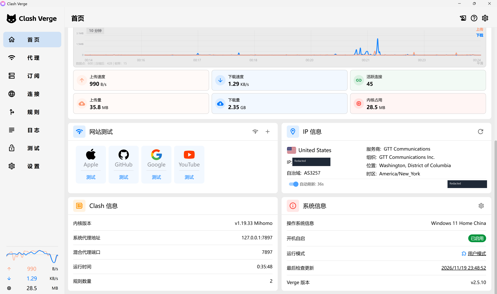

<div align="center">

# CAB · Claude Anti-Ban

**Claude 封禁风险研究与账户安全工程**

Windows Static Proxy Lab · Windows Proxy Doctor（网络代理医生）

**Agent Skill 优先 · 桌面应用 · 网络诊断 · 隐私检查 · 故障监测与恢复**

[项目介绍](#项目起源claude-封禁风险研究) · [推荐使用 Skill](#agent-skill) · [八项指标](#八项需求与证据边界) · [桌面应用](#桌面应用) · [分支与版本](#分支与版本) · [网络检测网站](#第三方网络检测网站) · [快速开始](#快速开始)

[](LICENSE) [](skills/windows-proxy-doctor/LICENSE)

`Windows 10/11` · `.NET 8 / WPF` · `PowerShell 5.1+` · `Python` · `Source Preview / RC`

</div>

> [!IMPORTANT]
> 本项目并非 Claude 官方产品，也未获得 Anthropic 的账户风控模型。网络检测不能证明账户不会被封禁；本项目不提供账号处置、地区资格或身份验证规避功能。**源代码合并 ≠ 稳定版发布 ≠ 本机生产部署。**

## 项目起源：Claude 封禁风险研究

**CAB（Claude Anti-Ban）是作者正式确定的项目名称。** 项目起源是 Claude 封禁风险研究，作者希望通过便捷的 Agent Skill、桌面应用与工程工具，研究网络异常、隐私泄漏和账户安全之间的关系，减少正常使用过程中的网络故障，并使诊断、监测和恢复操作尽可能易用。

历史工程采用 StarSky、Clash Verge Rev（Mihomo）与静态住宅 IP 服务三组件、双跳互联的实验架构。CAB 的工程目标包括系统级网络隐私检查、连接一致性与故障恢复能力。现有证据仅覆盖特定测试路径，不能保证真实 IP 在所有协议和异常场景下不被暴露，也不能证明账户不会被封禁。住宅代理 IP 是供应商提供的网络出口，并不等同于用户自己的物理住宅线路或所在位置。

Claude 连接稳定性与账户安全问题是项目的研究起点。Desktop、Agent Skill、CLI 与底层事务工程均由这一背景演进而来。原始八项需求、已验证的能力及尚未解决的问题见[历史需求文档](docs/V6.9-EIGHT-REQUIREMENTS.md)和[工程验收矩阵](https://github.com/LYL-Z/windows-static-proxy-lab/blob/fe8626db729ec1c5fde4df3ea16d4b57a17658f4/docs/V69-ACCEPTANCE.md)。项目当前提供的是可验证的网络可靠性与隐私诊断能力，并非已经实现的防封保证。

Claude 服务故障及账户问题分别以[官方服务状态](https://status.claude.com/)与[官方支持](https://support.claude.com/)为准。

## 项目概览

CAB 以 Windows Proxy Doctor 为工具组件，将历轮网络实验、事务恢复脚本、Agent Skill 与桌面诊断应用组织为同一产品体系。用户可以按需要选择可视化应用、自然语言助手或命令行，而不必手动阅读全部历史测试日志。每项能力分别记录测试方法、实际观测和覆盖范围。

| 入口 | 面向用户 | 当前版本及获取方式 |
| --- | --- | --- |
| 桌面应用 | 希望通过 GUI 查看网络状态、监测与故障建议的 Windows 用户 | [Desktop 1.0 开发候选 / PR #5](https://github.com/LYL-Z/windows-static-proxy-lab/pull/5) |
| Agent Skill | 使用 Codex 或兼容 Agent Skills 的用户 | [2.0.0 RC2 · 主支源码](skills/windows-proxy-doctor/) |
| CLI | 开发者、脚本调用者、诊断自动化 | [桌面候选 CLI](https://github.com/LYL-Z/windows-static-proxy-lab/tree/ec92e36422f0cee8f732ada5ee641281ac970502/desktop/src/ProxyDoctor.Cli) · [Skill 脚本](skills/windows-proxy-doctor/scripts/) |
| 底层事务工程 | 需要审查配置应用、恢复与隔离实验的开发者 | [V6.9 候选 / PR #4](https://github.com/LYL-Z/windows-static-proxy-lab/pull/4) |

## 快速开始

### 选择适合自己的入口

1. **首选：CAB Agent Skill。** 安装本仓库的 Windows Proxy Doctor Skill，重新加载支持本地工具的 Agent，然后用自然语言说明问题；它可根据环境发现结果逐步引导用户。
2. **图形界面用户：** 也可使用桌面候选进行只读检查；没有正式发布包时从指定源码构建，不要运行来路不明的 EXE。
3. **开发者：** 使用 CLI 或测试脚本查看结构化证据。事务脚本涉及系统状态变化时，先审查发布门槛与回滚流程。
4. **所有用户：** 保留现有正常网络，不需要为诊断功能购买指定代理服务。涉及安装、付款、凭据输入和生产修改时应分别核实、授权。

### 从一句自然语言开始

> 用 Windows Proxy Doctor 检查我的网络，先只读检查，告诉我故障在哪里和下一步该怎么做。



## 桌面应用

**CAB Desktop（Windows Proxy Doctor Desktop 1.0）— 开发候选。** 基于 C#、.NET 8、WPF 与 CommunityToolkit.Mvvm。默认以普通用户身份运行。

[](https://github.com/LYL-Z/windows-static-proxy-lab/blob/ec92e36422f0cee8f732ada5ee641281ac970502/desktop/overview.png)

截图来自该候选的实机运行记录，不能代表当前访问者的网络状态。

| 功能 | 当前候选状态 |
| --- | --- |
| 网络概览、客户端进程与监听 | 实时读取 |
| 故障分类与建议 | 已有只读实现 |
| HTTPS 状态码与耗时 | 已有实际探测；仅覆盖受测路径 |
| 20 秒本地心跳、90 秒 HTTPS 采样、托盘 | 已实现分通道采样；不能覆盖所有瞬时异常 |
| IPv4/IPv6 回环检查 | 已有现场检查入口；回环不代表公网数据面 |
| Claude 官方服务状态 | 候选已有状态接口检查；并非完整账户健康或资格判断 |
| 隐私协议检查 | 部分历史/实时结果；未测路径保持未验证 |
| 隔离事务恢复 | 真实调用审核过的回滚脚本；DPAPI 密封快照、完整证据判定；不写生产系统代理 |
| 生产自动修复、全局网络阻断 | 尚未部署或完成验收 |
| 安装包与代码签名 | 本地 win-x64 便携构建；未签名，无正式 MSI 发布 |

### 从候选源码构建

在 Windows 上准备 Git 与 [.NET 8 SDK](https://dotnet.microsoft.com/download/dotnet/8.0)。以下为可重复的候选源码构建流程，不替换生产网络配置。

```powershell
git clone https://github.com/LYL-Z/windows-static-proxy-lab.git
cd windows-static-proxy-lab
git switch --detach ec92e36422f0cee8f732ada5ee641281ac970502
cd desktop
dotnet test .\ProxyDoctor.sln -c Release
dotnet publish .\src\ProxyDoctor.Desktop\ProxyDoctor.Desktop.csproj -c Release -r win-x64 --self-contained true -o .\publish\win-x64
.\publish\win-x64\ProxyDoctor.exe
```

### 使用、更新与卸载

- 启动后选择只读检查，展开实际结果，区分演示数据、历史证据和本机实时数据。
- 使用托盘与本地监测查看状态变化；暂停和退出时应停止相应监测。
- `Aligned` 只表示观察到的代理选择和监听一致，并不证明任意应用或协议已经经过预期路径。
- 便携版退出后删除其发布目录即可移除程序文件；本地意图和事件记录可能保留在 `%LOCALAPPDATA%\ProxyDoctor`，如不再需要，可先备份再由用户自行清理。
- 更新时保留上一版本发布目录。自行构建的二进制 SHA-256 可能因构建环境不同而变化；候选原始发布哈希见 [SHA256SUMS.txt](https://github.com/LYL-Z/windows-static-proxy-lab/blob/ec92e36422f0cee8f732ada5ee641281ac970502/desktop/SHA256SUMS.txt)。SHA-256 不是 Authenticode 代码签名。

[桌面源码](https://github.com/LYL-Z/windows-static-proxy-lab/tree/ec92e36422f0cee8f732ada5ee641281ac970502/desktop) · [架构](https://github.com/LYL-Z/windows-static-proxy-lab/blob/ec92e36422f0cee8f732ada5ee641281ac970502/desktop/ARCHITECTURE.md) · [安全说明](https://github.com/LYL-Z/windows-static-proxy-lab/blob/ec92e36422f0cee8f732ada5ee641281ac970502/desktop/SECURITY.md)

## Agent Skill

**CAB Skill（Windows Proxy Doctor 2.0.0 RC2）是作者最推荐的使用入口。** 已合入主支作为候选源码。支持 Windows 10/11、Windows PowerShell 5.1 与兼容的后续 PowerShell 主机。实际执行能力取决于 Agent 是否拥有本地 Windows shell 与对应权限。

### 安装

1. 下载或克隆本仓库 `main`，保留完整的 `skills/windows-proxy-doctor` 文件夹。
2. 将内层 `windows-proxy-doctor` 复制到 Codex 项目的 `.agents/skills/` 或其他兼容 Agent 文档所指定的 Skill 目录。
3. 确认安装目录直接包含 `SKILL.md` 和 `scripts/`，然后重新加载 Agent 会话。
4. 输入下面任一自然语言指令，先进行只读诊断。

| 使用场景 | 示例指令 |
| --- | --- |
| 首次使用 | 用 Windows Proxy Doctor 检查我的网络 |
| 新手准备 | 帮我准备代理设置，我还没有相关软件 |
| 无网络流量 | 检查我的代理为什么没有正常工作 |
| 客户端重连 | StarSky 已经重新开启，但 Clash 没有流量 |
| 配置审核 | 检查我的电脑网络配置是否正常 |
| 恢复辅助 | 检查网络故障并提供恢复方案 |

Skill 会发现本机环境、识别故障、提供操作建议，并在用户拒绝某项修改后继续安全范围内的诊断。不会默认提权、自动注册付款或要求用户在对话中提交密码。


### Skill 的交互式准备流程

Skill 的原则是先发现、后确认、再操作。已经拥有合法可用的软件与服务的用户，无须重复购买。Agent 可在具备相应工具及获得授权后协助下载与安装软件；不能代替用户注册、验证身份、接受协议、付款或提供凭据。

| 阶段 | Agent 的职责 | 用户需要完成的事项 |
| --- | --- | --- |
| 1. 环境发现 | 检查 Windows、权限、StarSky、Clash Verge Rev、已安装版本、客户端状态与配置；缺失时提示 | 核对是否需要补装软件、确认安装授权 |
| 2. 软件准备 | 核查官方渠道、系统架构、版本及下载文件完整性；工具可用时协助安装 | 在官方界面完成必要操作、确认签名或官方摘要 |
| 3. 服务准备 | 询问已有服务是否满足合法用途，解释费用、流量、续费和协议差异 | 如确有需求，自行选择服务、注册、购买，并在可信客户端本地输入凭据 |
| 4. 配置审核与验收 | 基于已有环境检查配置是否兼容，展示影响与回退方式，按授权进行正常网络诊断 | 核对变更预览，确认或拒绝；复测原有正常应用 |
| 5. 故障恢复 | 分层诊断、给出具体操作与预期结果、保留检查点 | 如需手动操作，按页面提示完成；不懂时让 Agent 展开具体步骤 |

Agent 不应把“未找到软件”解释为必须购买服务；不应在聊天中索取代理密码或支付资料。遇到人工步骤时，应说明软件名称、页面位置、按钮、预期状态、失败后的恢复方法，并在用户确认后重新读取本机事实。中断后可以从检查点继续。

### 可选服务、参考费用与利益披露

以下是作者历史使用及提供的供应商资料，**不是使用 CAB Skill 的必要条件，不是 Claude 服务资格或防封保证**。价格为作者报告的人民币月费参考，未独立确认当前账号页面的具体报价，实际套餐及价格以供应商结算页面为准。

| 服务 | 作者提供的历史参考报价 | 普通官方入口 |
| --- | --- | --- |
| StarSky | 100 GB：9.9 元/月；200 GB：15 元/月 | [StarSky](https://skystars.top/) |
| Clash Verge Rev | 开源客户端，软件本身无需购买套餐 | [官方 Releases](https://github.com/clash-verge-rev/clash-verge-rev/releases) |
| NexIP 静态住宅代理服务 | 48 元/月（作者提供的参考价格，具体产品与协议以实际订单为准） | [NexIP 价格页](https://nexip.net/pricing/static-ip/) |

**邀请与返佣披露：** 作者提供的 StarSky 邀请入口可能使邀请人与受邀人均获流量奖励；NexIP 推荐入口可能使作者获得现金返佣。奖励条件、价格和是否适用须以供应商当前规则为准。完整链接、普通官方入口及安全核对事项均保存在 [可选服务与利益披露](skills/windows-proxy-doctor/references/providers.md)。用户可自行选择普通入口，无须通过邀请链接。邀请跳转不能作为安装包可信性的证明。

### PowerShell 只读入口

在 `skills/windows-proxy-doctor` 目录运行：

```powershell
powershell.exe -NoProfile -File .\scripts\Start-ProxyDoctor.ps1 -Goal Auto -Json
powershell.exe -NoProfile -File .\scripts\Get-ProxyDoctorEnvironment.ps1 -Json
```

前台观察、显式 HTTPS 探测、检查点以及软件完整性验证的参数参见下列文档。升级前退出正在使用的观察脚本，备份原 Skill，再替换完整文件夹；卸载或回退不应修改 Windows 网络设置。

[Skill 使用说明](skills/windows-proxy-doctor/README.md) · [新手指南](skills/windows-proxy-doctor/references/getting-started.md) · [环境发现](skills/windows-proxy-doctor/references/environment-discovery.md) · [权限与人工操作](skills/windows-proxy-doctor/references/user-interaction.md) · [发布门槛](skills/windows-proxy-doctor/RELEASE-GATE.md)

## 底层工程

历史工程从分层协议实验演进至配置事务与恢复机制。V6.9 候选继承并修复了快照回滚、用户主动关闭代理后的意图保留、日志异常、并发及异常退出等问题。



该图表达产品架构方向。不同入口的实现并非全部已共享同一个运行时；目前主要统一的是故障分类与证据语义。

| 工程路径 | 作用 |
| --- | --- |
| [`proxy_diag/`](proxy_diag/) | 历史分阶段协议探测与诊断 |
| [`proxy_v2/`](proxy_v2/) | 历史事务配置、回退和基准实验 |
| [`proxy_v3/`](proxy_v3/) | 状态机、故障注入和网络协议观察 |
| [`proxy_v4/`](proxy_v4/) | 主支历史事务引擎；最新候选仍在 PR #4 |
| [V6.9 测试与验收](https://github.com/LYL-Z/windows-static-proxy-lab/blob/fe8626db729ec1c5fde4df3ea16d4b57a17658f4/docs/V69-ACCEPTANCE.md) | 当前候选验收矩阵 |
| [V6.9 部署及回滚](https://github.com/LYL-Z/windows-static-proxy-lab/blob/fe8626db729ec1c5fde4df3ea16d4b57a17658f4/docs/V69-DEPLOY.md) | 尚未部署的候选及生产授权边界 |

### 典型环境的观测示意



示意图不是网络配置教程。系统代理状态、客户端 UI、监听归属与实际应用数据面需要分别验证。

## 故障处理

| 观察到的现象 | 推荐第一步 |
| --- | --- |
| StarSky 自行停止 | 记录发生时间和客户端状态，通过只读诊断核对监听及普通应用访问；原因尚未确定 |
| 上游恢复后 Clash 仍无流量 | 区分核心监听、系统代理与应用实际请求，按故障手册确认最小恢复操作 |
| 系统代理被关闭 | 区分观察到关闭与已知的用户主动选择，不擅自开启 |
| 两款客户端状态不一致 | 检查实际监听及代理所有权；不把界面开关当作数据面证据 |
| DNS、IPv6、WebRTC 结果不一致 | 查看对应协议的独立测量与测试范围；不把超时或空结果当作明确阻断 |
| Claude 等服务不可访问 | 先检查普通连接和官方服务状态；涉及账号或资格时走官方支持渠道 |

实际修复需要核对影响和权限。候选自动恢复尚未生产验收，桌面恢复演练不修改系统。

[完整故障手册](skills/windows-proxy-doctor/references/troubleshooting.md) · [生命周期现场记录](skills/windows-proxy-doctor/references/lifecycle-observations.md) · [已知可靠性缺口](skills/windows-proxy-doctor/references/reliability-gaps.md) · [Claude 官方服务状态](https://status.claude.com/) · [Anthropic 官方支持](https://support.claude.com/)

## 八项需求与证据边界

以下八项是 CAB 的历史需求及对应的可验证工程指标。原始需求全文保存在 [需求原文与工程验收矩阵](docs/V6.9-EIGHT-REQUIREMENTS.md)，当前候选状态参见 [Desktop 需求追踪](https://github.com/LYL-Z/windows-static-proxy-lab/blob/ec92e36422f0cee8f732ada5ee641281ac970502/desktop/REQUIREMENTS.md)。需求记录不代表已完成，现阶段没有一项取得完整生产保护验收。

| 工程能力 | 最新已记录的边界 |
| --- | --- |
| 1. Internet Kill Switch（网络断网开关） | 隔离进程守卫仅覆盖其启动的作业；整机网络阻断未部署、未验收 |
| 2. Clear Flash Cookies & Clear Cookies（浏览数据卫生） | Flash 已淘汰；桌面候选不清理真实站点数据；清理 Cookie 不等于重置设备身份 |
| 3. Fix DNS Leak（DNS 隐私） | DNS / DoH 可用性有观测；系统和浏览器实际解析路径仍未完整验证 |
| 4. Fix IPv6 Leak（IPv6 路径覆盖） | 回环拒绝和超时分别记录；不代表公网路径已保护 |
| 5. Fix WebRTC IP Leak（WebRTC 隐私） | 有限实验不代表真实应用；当前桌面候选未完成浏览器 WebRTC 验收 |
| 6. DNS、IPv6、WebRTC 持续监测 | 按协议独立展示；持续生产保护尚未部署 |
| 7. 应用连接稳定性、异常路径与 IP 一致性 | 仅普通 HTTPS 和公开服务状态可测；Claude 桌面、网页及异常路径的端到端保护未验收 |
| 8. StarSky / Clash Verge 故障诊断与恢复 | 已有 Skill、托盘监测、隔离回滚；尚无适用于当前 StarSky 版本的官方自动重连接口及生产无人值守恢复 |

## 现场记录

下图为历史客户端界面，已按 Skill 发布资料处理遮盖。不是当前网络状态。

| StarSky | Clash Verge |
| --- | --- |
|  |  |

历史第三方检测截图仅用于解释不同协议的观测差异：[路径观察](docs/media/historical-path-observation.png) · [网络摘要](docs/media/historical-network-summary.png)。评分不代表平台账号风险，也不是项目验收指标。

## 第三方网络检测网站

| 网站 | 用途 |
| --- | --- |
| [Net.Coffee](https://ip.net.coffee/) | IP 信息及网络诊断 |
| [IPinfo](https://ipinfo.io/) | IP 与自治系统信息查询 |
| [BrowserLeaks](https://browserleaks.com/) | 浏览器网络与隐私特征检查 |

网站观测仅代表发起测试时的路径和该站点的测量方法，不能证明系统级 IP 纯净性、账户资格或封禁风险。不同站点的结果可能因协议、数据库及时间而异；避免上传完整 IP、账户资料或私密日志。

## 分支与版本

CAB 采用主支、候选 PR 与独立工作分支协作开发。以下为 2026-11-25 查询到的 18 个远端分支；工作分支职责依据其命名及当前开发计划描述，不代表已通过验收。

| 主干及候选分支 | 内容 | 当前状态 |
| --- | --- | --- |
| [main](https://github.com/LYL-Z/windows-static-proxy-lab/tree/main) | 公共首页、历史工程、已合并 Skill 及原始需求文档 | 主支 |
| [v5/short-run-hardening](https://github.com/LYL-Z/windows-static-proxy-lab/tree/v5/short-run-hardening) | V6 事务与短周期测试 | [PR #1](https://github.com/LYL-Z/windows-static-proxy-lab/pull/1) Draft |
| [skill/windows-proxy-doctor](https://github.com/LYL-Z/windows-static-proxy-lab/tree/skill/windows-proxy-doctor) | Skill 2.0.0 RC2 | [PR #2](https://github.com/LYL-Z/windows-static-proxy-lab/pull/2) 已合并 |
| [docs/v69-eight-requirements-20261121](https://github.com/LYL-Z/windows-static-proxy-lab/tree/docs/v69-eight-requirements-20261121) | 八项历史需求 | [PR #3](https://github.com/LYL-Z/windows-static-proxy-lab/pull/3) 已合并 |
| [v69/isolated-privacy](https://github.com/LYL-Z/windows-static-proxy-lab/tree/v69/isolated-privacy) | V6.9 隔离验证、快照密封与事务 | [PR #4](https://github.com/LYL-Z/windows-static-proxy-lab/pull/4) Draft |
| [desktop/windows-proxy-doctor](https://github.com/LYL-Z/windows-static-proxy-lab/tree/desktop/windows-proxy-doctor) | WPF 桌面应用、CLI、共享诊断核心 | [PR #5](https://github.com/LYL-Z/windows-static-proxy-lab/pull/5) Draft |
| [skill/recovery-verdict](https://github.com/LYL-Z/windows-static-proxy-lab/tree/skill/recovery-verdict) | Skill 恢复结果严格判定 | [PR #6](https://github.com/LYL-Z/windows-static-proxy-lab/pull/6) Draft |

| 子代理工作分支 | 规划职责 |
| --- | --- |
| `agent/a-snapshot` | 快照安全 |
| `agent/b-privacy` | 公开内容及隐私审计 |
| `agent/c-contract` | 共享结果契约 |
| `agent/c-skill` | Skill 契约 |
| `agent/e-clients` | 客户端生命周期 |
| `agent/f-monitor` | 持续监测 |
| `agent/g-protocols` | 协议诊断 |
| `agent/i-desktop-ui` | 桌面界面 |
| `agent/j-cli` | CLI 集成 |
| `agent/j-skill` | Skill 集成 |
| `agent/k-package` | 软件打包 |

[查看全部实时分支](https://github.com/LYL-Z/windows-static-proxy-lab/branches) · [Pull Requests](https://github.com/LYL-Z/windows-static-proxy-lab/pulls) · [Issues](https://github.com/LYL-Z/windows-static-proxy-lab/issues)

## 开发与验收

截至 2026-11-25 的源代码和已报告测试记录：

| 工作线 | 证据对应版本 | 已记录的测试 | 发布状态 |
| --- | --- | --- | --- |
| Skill | `2e2b6c3` | 21 项故障分类；此前 `eb1d521` 另有 14 组诊断、24 组向导测试 | 主支 RC2 源码；新设备验收未完成 |
| V6.9 | `52df351`（说明提交 `fe8626d`） | 114/114 隔离回归、0 跳过、退出码 0；DPAPI 密封新快照 | Draft；未部署 |
| Desktop | `ec92e36` | 27/27；隔离事务恢复证据 | Draft；未签名开发候选 |
| Skill 恢复判定 | `ad88522` | 15/15 | Draft；未合并 |

上述为各工作线已有测试记录，**不是合并后主支的统一 CI 结果**。本次主支文档整合没有重新执行 Windows 测试。完整发布前应对冻结候选进行回归、独立审查、隐私扫描和真实设备验收。

| PR | 内容及关系 |
| --- | --- |
| [#1](https://github.com/LYL-Z/windows-static-proxy-lab/pull/1) | V6 底层工程；发布安全事项未全部关闭 |
| [#2](https://github.com/LYL-Z/windows-static-proxy-lab/pull/2) | Skill RC2，已合入 main |
| [#3](https://github.com/LYL-Z/windows-static-proxy-lab/pull/3) | 历史需求与边界，已合入 main |
| [#4](https://github.com/LYL-Z/windows-static-proxy-lab/pull/4) | V6.9，基于 #1 |
| [#5](https://github.com/LYL-Z/windows-static-proxy-lab/pull/5) | 桌面端，基于 #4 |
| [#6](https://github.com/LYL-Z/windows-static-proxy-lab/pull/6) | Skill 恢复契约，基于 main |

## 路线图

- **Desktop：** 完善交互式逐项检测、可取消的持续监测、事件持久化、无障碍、故障恢复体验、正式安装包与签名。
- **Skill：** 统一故障语义，继续真实 Agent 与新设备端到端验收。
- **Engine：** 关闭历史安全问题，验证事务恢复、回滚与生产授权流程。
- **Release：** 在冻结源码、统一回归、安全审查和真实设备验收完成后发布稳定版；现阶段不宣称已经完成所有需求。

## 安全、许可证与贡献

默认最小权限。不要上传代理凭据、浏览器会话、私密快照、完整网络地址或带个人信息的日志。V6.9 候选新增 DPAPI CurrentUser 密封快照，生产历史明文快照尚未迁移；公开历史中曾发现疑似凭据样式资料，仍待独立审计与处置。历史备份必须在本地妥善保管。不要关闭安全防护来换取测试通过。

- [仓库安全说明](SECURITY-NOTES.md)
- [Skill 安全说明](skills/windows-proxy-doctor/SECURITY.md) 与 [MIT 许可证](skills/windows-proxy-doctor/LICENSE)
- [V6.9 发布门槛](https://github.com/LYL-Z/windows-static-proxy-lab/blob/fe8626db729ec1c5fde4df3ea16d4b57a17658f4/proxy_v6/RELEASE-GATE-V6.md)
- [桌面第三方声明](https://github.com/LYL-Z/windows-static-proxy-lab/blob/ec92e36422f0cee8f732ada5ee641281ac970502/desktop/THIRD-PARTY-NOTICES.md)

### 开源许可证

CAB 项目原创软件与原创说明文档采用 **[Apache License 2.0](LICENSE)** 作为默认许可证。既有 CAB Skill 保留 **[MIT License](skills/windows-proxy-doctor/LICENSE)**。第三方组件、独立许可文件、商标、截图和外部资料不因根许可证而自动获得重新授权。

| 内容 | 授权方式 |
| --- | --- |
| CAB 自有原创代码、原创文档 | Apache-2.0 |
| CAB Skill（`skills/windows-proxy-doctor/`） | MIT（既有许可） |
| 第三方组件与外部素材 | 各自原始许可及权利范围 |

Apache-2.0 允许商业使用、修改和再分发，规定版权及归属保留、修改说明和专利授权等条件，不自动授予商标权。详见许可证原文。CAB 与 Claude、Anthropic 或其他厂商没有官方隶属或背书关系。

[版权与归属 NOTICE](NOTICE) · [第三方许可声明](THIRD-PARTY-NOTICES.md) · [许可证审查记录](docs/LICENSE-AUDIT.md) · [贡献规范](CONTRIBUTING.md)。

许可证审查覆盖 2026-11-25 可见的 18 个远端分支及已声明直接依赖；完整发行包的传递依赖与权属审计仍待完成。候选分支应在集成时继承上述许可范围，并保留任何已有的独立许可证。供应商入口、费用和推荐奖励按 [披露文件](skills/windows-proxy-doctor/references/providers.md) 核实。

提交 Issue 时请包含 Windows 版本、客户端版本、故障发生时间、复现步骤、脱敏诊断和预期结果。贡献请基于独立分支，提供对应测试，不将本机配置或秘密写入版本库。

---

<div align="center">CAB · Claude Anti-Ban · Evidence before claims · 安全、可验证、可恢复</div>
