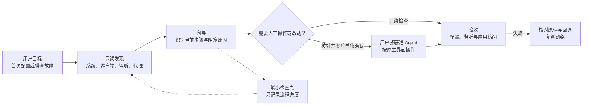
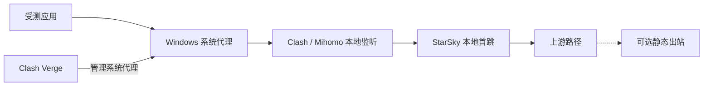
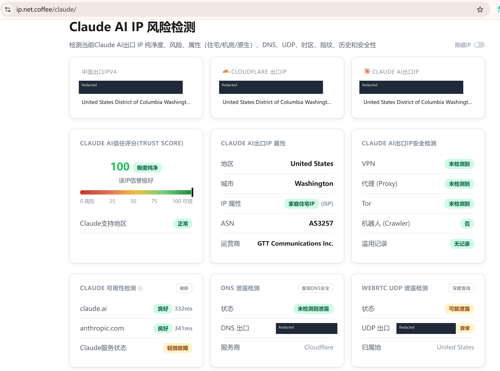
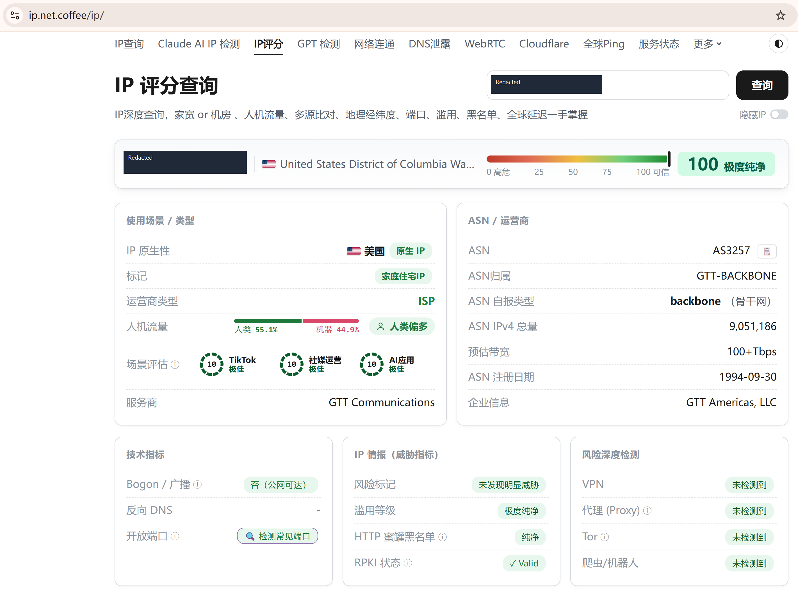

# Windows Static Proxy Lab

**面向普通 Windows 用户的网络检查与配置助手。**

不知道该装哪个客户端，或者代理界面显示已连接但网站打不开？Windows Proxy Doctor 先检查本机现状，再告诉你当前卡在哪一步、需要谁操作，以及如何验证结果。

[首次使用](skills/windows-proxy-doctor/references/getting-started.md) · [安装、升级与卸载](skills/windows-proxy-doctor/README.md) · [故障手册](skills/windows-proxy-doctor/references/troubleshooting.md) · [2.0.0 候选](https://github.com/LYL-Z/windows-static-proxy-lab/pull/2)

## 从一次只读检查开始

在支持本地 Skill 的 Agent 中安装 [Windows Proxy Doctor](skills/windows-proxy-doctor/)，然后说：

> 帮我检查这台 Windows 电脑的网络，告诉我下一步怎么做。先只读检查。

首次发现会识别 Windows、权限、已登记或正在运行的客户端、代理设置和相关监听。诊断可独立使用。配置时可以继续用已有服务，或在看过费用与邀请利益披露后选择供应商。应用设置、软件安装和账号操作按对应授权处理。

## 架构与证据

在示范拓扑中，**Clash Verge 管理 Windows 系统代理，StarSky 提供本地首跳**。可选静态出站取决于用户已有服务和当前客户端文档。每层都应单独验收，尤其是在节点切换、重连或退出之后。

## 现场图与历史观测

四张图片均来自实机或实际第三方检测页面。公开副本遮盖了网络地址、账号等字段。图片展示的是当时的状态，跨重启持久性和无人值守恢复仍待独立验证。

| StarSky 实机界面 | Clash Verge 实机界面 |
| --- | --- |
|  |  |

| 历史路径观察 | 历史网络摘要 |
| --- | --- |
|  |  |

第三方评分属于该页面当次观测，服务资格以平台自己的规则为准。第一张历史图同时保留 WebRTC 的 UDP 异常提示。项目以 Windows 实际代理指向、监听归属和普通 HTTPS 请求验收网络，并分别记录 TCP、DNS 与 UDP。

| 验证范围 | 当前证据 |
| --- | --- |
| 双客户端共享代理 | 历史现场曾观察到 Windows 指向首跳，Clash 路径仍可用。在授权窗口关闭首跳客户端的自动系统代理后，三个本地入口和两站 HTTPS 均通过当前会话验收。 |
| 节点切换、自停与重连 | 用户观察到正常换节点时 Clash 继续工作。另一次 StarSky 自停后，重新加速后仍需重启 Clash 才恢复。开机样本伴随人工重新激活订阅。 [详细现场记录](skills/windows-proxy-doctor/references/lifecycle-observations.md) |
| 2.0.0 向导 | Release Candidate。代码、安装说明和回归随 [Draft PR #2](https://github.com/LYL-Z/windows-static-proxy-lab/pull/2) 更新，另一台真实新设备尚待验收。 |

## 仓库入口

| 路径 | 用途 |
| --- | --- |
| [`skills/windows-proxy-doctor/`](skills/windows-proxy-doctor/) | 可独立安装的交互式 Skill、诊断脚本、测试与帮助文档 |
| [`proxy_v4/`](proxy_v4/) | 历史工程的事务、恢复与状态工具 |
| [工程 Draft PR #1](https://github.com/LYL-Z/windows-static-proxy-lab/pull/1) | 单独审阅生产候选、恢复边界与历史工程验证 |
| [安全与授权](skills/windows-proxy-doctor/SECURITY.md) · [仓库安全说明](SECURITY-NOTES.md) | 本地数据边界、备份及发布前核对 |

Skill 采用 [MIT 许可](skills/windows-proxy-doctor/LICENSE)。
